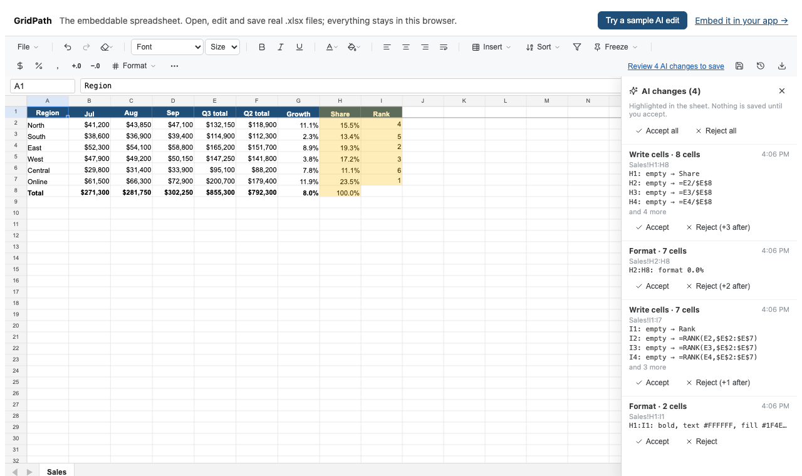
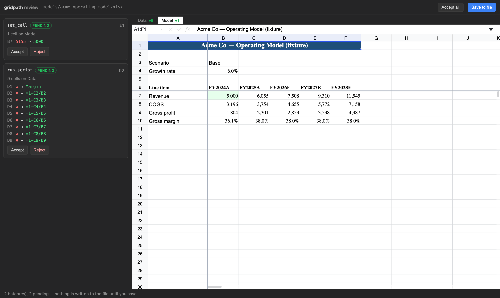
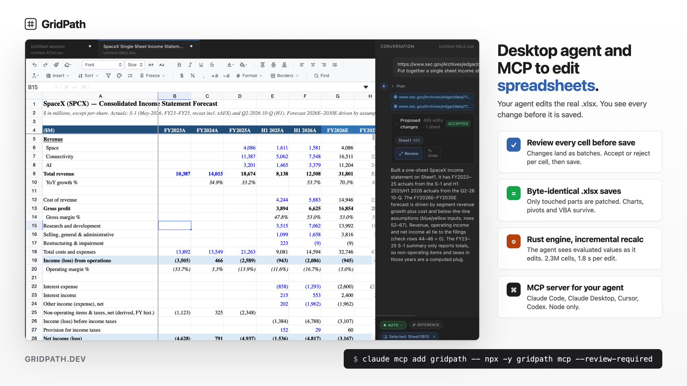

<p align="center">
  
</p>

# GridPath

**Real Excel files, in your web app and in your agent.**

GridPath opens the `.xlsx` files people already have and calculates every
formula with a Rust engine. AI can edit the files, with a review step. The
saved file patches the original: untouched parts come back byte-identical,
while recalculated formulas and supported chart data caches carry current values.

| | **In your web app**: `npm install gridpath` | **In your coding agent**: `npx gridpath mcp` | **Desktop app** |
|---|---|---|---|
| What it is | A spreadsheet component for your product. It opens your users' `.xlsx` files and saves them back intact, to their browser or to your backend. | An MCP server: spreadsheet tools for the coding agent you already use. | A desktop editor with its own agent. |
| The agent | Yours: your model and key, on your server. | Yours: Claude Code, Cursor, Codex, or any MCP host. | GridPath's own, in the app. |
| You review | Highlighted in the grid; accept or reject. | In a local browser tab the agent links you to. | In the app's diff panel. |
| Start | [The guide](packages/gridpath#in-your-web-app) · [live demo](https://gridpath.dev/demo) · [Next.js example](examples/nextjs-demo) | [Setup](packages/gridpath#in-your-coding-agent-mcp) · [gridpath.dev/mcp](https://gridpath.dev/mcp) | [Download](https://gridpath.dev/#download) |

The engine, the in-place saver and the `gridpath` package (the web spreadsheet and the MCP server) are open source under [Apache-2.0](LICENSE). The desktop app is source-available under the FSL-1.1-Apache-2.0 ([details](#license)).

## In your web app

```sh
npm install gridpath react react-dom
```

```tsx
import { Spreadsheet, httpStore } from "gridpath";

const store = httpStore({ url: "/api/books" }); // or leave `store` out to save in the browser

<div style={{ height: 600 }}>
  <Spreadsheet
    store={store}
    documentId={book.id}
    onReady={(sheet) => (sheetRef.current = sheet)}
    onError={(err) => console.error(err.code, err.message, err.hint)}
  />
</div>;
```

Without any further code, users get:

- a formatting toolbar;
- saving as they work, with a status that says where: "Saved in this
  browser" or "Saved to your account";
- version history and a Recent list;
- Download as `.xlsx`;
- an "AI changes" panel for reviewing an agent's edits.

Your code gets:

- a small API: `getCell`, `setCell`, `save`, `open`, `openStored`…, with
  stated contracts;
- typed errors, each with a code and a hint you can show;
- the agent tools for your own model (`sheet.ai`).

When saving to your backend fails, nothing is lost. The edits wait in the
browser and the save is retried.

- [The guide and API reference](packages/gridpath#in-your-web-app)
- [A complete Next.js app](examples/nextjs-demo), with auth and REST routes
- [The live demo](https://gridpath.dev/demo)

Against the spreadsheet components a web app would otherwise embed (on real
models in Chromium, [method and results](eval/embed-bench#results-2026-10-19)):

- **Opening.** GridPath opens a 1.4 MB analyst model and recalculates it
  in 0.8 s. SpreadJS takes 3.6 s; Handsontable with HyperFormula and
  ExcelJS takes 1.9 s.
- **Saving.** GridPath keeps 75 of the file's 76 parts byte-identical.
  The others drop custom XML, printer settings and more.
- **Scale.** On a model with 2.3M cells, SpreadJS crashes the tab.
  GridPath opens it and updates the dependents of an edit in 2.7 s.

## In your coding agent (MCP)

```sh
claude mcp add gridpath -- npx -y gridpath mcp --review-required
```

Your agent edits the real `.xlsx` through GridPath's tools:

- describe, find, read and write;
- `run_script`;
- structural operations (rows, columns, sheets).

Every change returns a readback and a **review link**, which shows each
changed cell before and after; accept or reject per batch, then save.

- Nothing is written until you save.
- With `--review-required`, only the review page can save.
- No Python, no LibreOffice, no Excel needed.

Details, host config snippets and the tool list:
[packages/gridpath/README.md](packages/gridpath#in-your-coding-agent-mcp).

The same edit takes a fraction of the time and tokens, because the agent
calls spreadsheet tools instead of writing and debugging scripts. Claude
Code (Sonnet 5.5) on a real 1.4 MB, 55,000-formula analyst model, with the
same prompt with and without GridPath:

| Task | With GridPath | Without |
|---|---|---|
| Insert a row (median of 5 runs) | **17 s** · 1.0k output tokens · $0.35 | 52 s · 6.1k · $0.86 |
| Change 12 inputs and report the recalculated result (1 run) | **29 s** · 2.2k output tokens · $0.49 | 161 s · 17.1k · $1.62 |

Both lanes got every edit right. The difference is time, tokens, and seeing
the diff before anything is saved. The full runs, including the ones we
lose, are in the [evals repo](https://github.com/pixelsmasher13/gridpath-evals).

[](https://gridpath.dev/mcp)

## Desktop app

<p align="center">
  
</p>

Open a `.xlsx`, type what you want, review the diff, accept it. Multiple
workbooks side by side, each with its own agent; other files attachable as
read-only references. Your file never leaves your machine, and it works with
the Claude or ChatGPT subscription you already pay for.

**[Download GridPath](https://gridpath.dev/#download)**

### What the app does

- **Multi-workbook** — Workbooks side by side, each with its own agent. Attach others as read-only references.
- **Reversible changes** — Diff-first edits. Accept, reject or use ⌘Z. Nothing saves until you say so.
- **Spreadsheet-native harness** — With the same model, GridPath ran 3.9–14× faster in our [benchmarks](https://github.com/pixelsmasher13/gridpath-evals) and used 95–96% fewer output tokens on edit tasks.
- **Workbook fidelity** — Surgical saves rewrite only what changed; charts, pivots, formatting, VBA and plugin data stay intact.
- **Formula-first** — Writes formulas, not pasted numbers, so models stay live.
- **Local-first** — Your `.xlsx` stays on disk. Only your prompt and the cells the agent needs go to Claude or OpenAI.

### How the desktop app compares

| | GridPath | Excel Copilot | Claude for Excel | ChatGPT upload | CLI coding agent |
|---|---|---|---|---|---|
| Edits your existing `.xlsx` in place | ✅ | ✅ | ✅ | ❌ | ✅ |
| Workbook stays on your machine | ✅ | ❌ | ❌ | ❌ | ✅ |
| Preserves charts, pivots, plugin data | ✅ | ✅ | ✅ | ❌ | ❌ |
| Accept/reject diff before changes land | ✅ | partial | partial | ❌ | ❌ |
| Choose and switch the model | ✅ | ❌ | ❌ | ❌ | ✅ |
| Parallel sessions across workbooks | ✅ | ❌ | ❌ | ❌ | partial |
| Source available | ✅ | ❌ | ❌ | ❌ | ❌ |
| Included with a subscription you have | ✅ | ❌ | ✅ | ✅ | ✅ |

*Best-effort comparison as of September 2026. The "preserves" and "diff" rows for coding agents are measured, not inferred — see the [benchmark repo](https://github.com/pixelsmasher13/gridpath-evals). On the August 2026 models a headless coding agent silently dropped parts of a workbook in 2 of 5 edit runs; on Sonnet 5.5 (September 2026) it preserved every part in all of our runs by choosing XML surgery on its own. GridPath preserves them by construction, not by the model's judgment on the day.*

## Project status

Under active development.

- **The web package** is at 0.5: it draws a workbook's line charts, which
  update as you edit and save as native Excel charts, and opens CSV and
  other delimited text. Other chart types, creating charts,
  data-validation dropdowns and real-time collaboration are not supported yet.
- **For agents**, editing existing workbooks is the strongest path, and the
  one benchmarked continuously. Building large multi-sheet models from
  scratch works but is still improving. The
  [benchmark repo](https://github.com/pixelsmasher13/gridpath-evals)
  publishes those results too, including the ones we lose.

## License

**Open source (Apache-2.0, [LICENSE](LICENSE)):** the calculation engine and
in-place saver (`crates/`, the IronCalc fork in `vendor/ironcalc`), the
`gridpath` package (`packages/gridpath`, `packages/grid`: the web
spreadsheet, the agent tools, the MCP server), the examples and the evals.
Use them in anything, commercial or not, including closed-source products.

**Source-available (FSL-1.1-Apache-2.0):** the desktop app (`src/`,
`src-tauri/`) and the hosted services (`proxy-server/`, the desktop app's
sign-in, and `marketing/`, the site), each with its own LICENSE file. You can
read, modify and run them for any use except a competing product; each
release becomes Apache-2.0 two years after it ships.

"GridPath" and the logo are trademarks ([TRADEMARKS.md](TRADEMARKS.md)).
Releases of the `gridpath` npm package before 0.2.0 were FSL-1.1-Apache-2.0.

## Build from source

Requires **Node 20+**, **Rust** stable via [rustup](https://www.rust-lang.org/tools/install), and your platform's [Tauri prerequisites](https://v2.tauri.app/start/prerequisites/).

```bash
npm install
npm run tauri dev
```

`npm run tauri build` produces a local unsigned build. On first launch, connect Claude with OAuth or an API key, or use the ChatGPT sign-in flow. Credentials stay in the local SQLite database.

### Architecture

GridPath uses Tauri 2 with a Rust core, React and TypeScript, a vendored [IronCalc](vendor/ironcalc) fork (MIT/Apache-2.0), and SQLite. The surgical `.xlsx` patcher is in `src-tauri/src/engine/workbook/xlsx_patch/`, the agent loop in `src-tauri/src/engine/spreadsheet_agent/`, and the benchmark harness in `eval/`.
